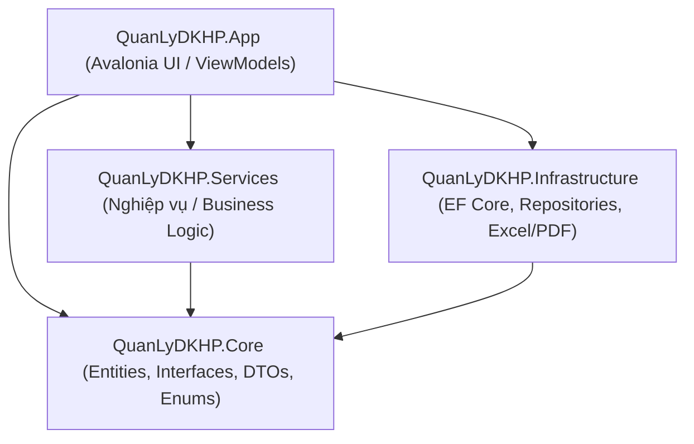
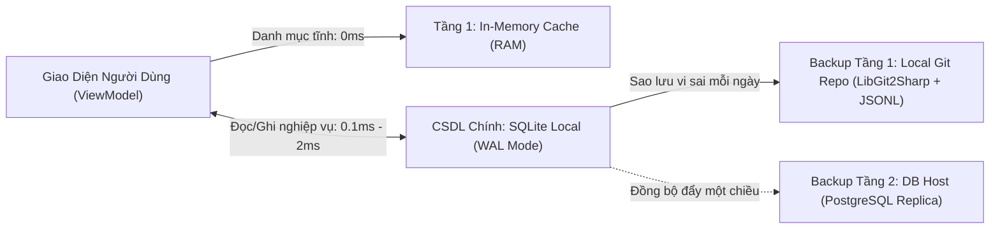

# Kiến Trúc Hệ Thống & Thiết Kế Phần Mềm

## 1. Mô Hình Clean Architecture

Hệ thống được thiết kế tuân thủ nghiêm ngặt nguyên lý **Clean Architecture** (Kiến trúc Sạch), phân tách mã nguồn thành 4 tầng riêng biệt nhằm đảm bảo tính độc lập, dễ kiểm thử (Testability) và khả năng bảo trì lâu dài.



### Chi tiết các tầng trong Solution

1. **`QuanLyDKHP.Core` (Tầng trung tâm - Domain Core):**
   * Hoàn toàn độc lập, không tham chiếu tới bất kỳ tầng nào khác.
   * Chứa các thực thể miền (Domain Entities: `SinhVien`, `MonHoc`, `LopHocPhan`, `DangKyHocPhan`, `NguoiDung`, `CauHinhHeThong`).
   * Chứa các hợp đồng giao tiếp (Interfaces cho Repositories và Services), DTOs phục vụ truyền nhận dữ liệu, Enums định danh và ma trận quyền hạn (`PermissionMatrix`).
2. **`QuanLyDKHP.Infrastructure` (Tầng hạ tầng & Dữ liệu):**
   * Triển khai chi tiết các Interface từ tầng Core.
   * Quản lý ngữ cảnh cơ sở dữ liệu EF Core (`AppDbContext`), cấu hình Fluent API, Database Migrations cho PostgreSQL (Neon Cloud / Local) và SQLite.
   * Triển khai xuất nhập dữ liệu: ClosedXML (Excel) và QuestPDF (PDF chuẩn A4).
3. **`QuanLyDKHP.Services` (Tầng Nghiệp vụ - Business Logic):**
   * Hiện thực hóa các quy trình nghiệp vụ: Xác thực đăng ký học phần 5 bước, công thức tính học phí, kiểm soát sĩ số, lập báo cáo thống kê, băm mật khẩu bảo mật (BCrypt).
   * Đảm bảo mọi luồng xử lý đều được kiểm tra điều kiện tiên quyết và kiểm thử tự động độc lập thông qua Mocking.
4. **`QuanLyDKHP.App` (Tầng Trình diễn - Presentation UI):**
   * Ứng dụng Desktop đa nền tảng dựa trên **Avalonia UI 11.x**.
   * Áp dụng mô hình **MVVM** với bộ công cụ `CommunityToolkit.Mvvm`.
   * Chịu trách nhiệm hiển thị giao diện, tiếp nhận tương tác người dùng, quản lý trạng thái màn hình và cấu hình Dependency Injection (IoC Container).

---

## 2. Mô Hình MVVM (Model - View - ViewModel)

Giao diện người dùng được xây dựng hoàn toàn dựa trên MVVM, tách biệt logic hiển thị khỏi định nghĩa giao diện XAML:

* **View (XAML):** Định nghĩa layout, styles, data templates và hiệu ứng đồ họa. View chỉ liên kết (Data Binding) với ViewModel thông qua cơ chế `DataContext`.
* **ViewModel:** Kế thừa từ `ObservableObject`. Sử dụng các Source Generator của `CommunityToolkit.Mvvm` (`[ObservableProperty]`, `[RelayCommand]`) để giảm thiểu mã lặp.
* **Giao tiếp liên ViewModel (Loose Coupling):** Sử dụng `WeakReferenceMessenger` để truyền thông điệp giữa các màn hình mà không giữ tham chiếu chặt (ví dụ: chuyển từ màn Sinh viên sang màn Đăng ký học phần kèm mã sinh viên đã chọn).

---

## 3. Quản Lý Ngữ Cảnh Cơ Sở Dữ Liệu: `IDbContextFactory`

Trong môi trường ứng dụng Desktop với giao diện phản hồi nhanh và các tác vụ nền song song (Background Workers), việc sử dụng chung một `DbContext` Scoped là nguyên nhân chính dẫn đến lỗi xung đột luồng:
```text
System.InvalidOperationException: A second operation was started on this context instance before a previous operation completed.
```

:::note[Giải pháp kiến trúc]
Hệ thống chuyển đổi toàn diện sang mô hình **Factory Pattern** thông qua `IDbContextFactory<AppDbContext>`.
* Cấu hình đăng ký tại DI Container: `services.AddDbContextFactory<AppDbContext>(...)`.
* Mỗi phương thức trong Repository tự khởi tạo và giải phóng một DbContext cục bộ trong một phạm vi ngắn:
```csharp
await using var context = await _contextFactory.CreateDbContextAsync(cancellationToken);
return await context.SinhViens.AsNoTracking().ToListAsync(cancellationToken);
```
Giải pháp này giải quyết triệt để vấn đề tranh chấp luồng và ngăn ngừa rò rỉ bộ nhớ (Memory Leak) do Change Tracker tích lũy trong vòng đời ứng dụng Desktop.
:::

---

## 4. Kiến Trúc CSDL Cục Bộ (Local-First SQLite Primary) & Sao Lưu Đa Tầng Kiểu Git

Trong giai đoạn đầu ([F10](./chuc-nang/F10-hybrid-cache-delta-sync.md)), hệ thống sử dụng Cloud PostgreSQL làm CSDL chính kết hợp SQLite làm bộ nhớ đệm đọc. Tuy nhiên, để đáp ứng quy định bảo mật vận hành thực tế — **cán bộ nội vụ chỉ thực hiện nghiệp vụ trên máy tính cố định tại văn phòng** — kiến trúc đã được nâng cấp lên mô hình **Local-First SQLite Primary kết hợp Sao lưu Đa tầng ([F11](./chuc-nang/F11-local-sqlite-git-backup.md))**:



1. **Tầng 1 - In-Memory Cache Store (Singleton - 0ms):**
   * Lưu trữ các bảng dữ liệu danh mục tĩnh hoặc ít biến động: Học kỳ, Khóa học, Danh mục Môn học, Lớp sinh hoạt.
   * Dữ liệu được nạp song song ngay khi khởi động thông qua `Task.WhenAll`. Các combobox và bộ lọc lấy dữ liệu trực tiếp từ RAM với độ trễ phản hồi **0ms**.
2. **CSDL Chính - SQLite Local Database (`WAL Mode` - 0.1ms đến 2ms):**
   * Toàn bộ thao tác đọc và ghi nghiệp vụ diễn ra trực tiếp trên tệp SQLite cục bộ (`quanlydkhp.db`) tại máy tính cố định ở văn phòng với chế độ `PRAGMA journal_mode = WAL;` và `PRAGMA foreign_keys = ON;`.
   * Thiết kế tương thích sẵn sàng với **SQLCipher (mã hóa AES-256 cấp độ tệp)** khi cần nâng cấp bảo mật vật lý.
3. **Hệ thống Sao lưu Đa tầng (Git-Style Local Backup & Remote DB Host):**
   * **Sao lưu cục bộ kiểu Git (`LibGit2Sharp`):** Cuối mỗi ngày làm việc (hoặc theo thao tác thủ công), hệ thống xuất 8 bảng ra định dạng văn bản chuẩn hóa theo dòng (`Canonical Sorted JSONL`) và thực hiện `git commit` tự động. Nhờ thuật toán nén vi sai của Git, mỗi bản lưu hằng ngày chỉ ghi nhận đúng những dòng dữ liệu thay đổi (tốn vài KB) và cho phép khôi phục (`Time-Travel Restore`) về bất kỳ ngày nào trong quá khứ.
   * **Sao lưu lên DB Host (`One-Way Push Replica`):** Tùy chọn đẩy các bản ghi mới/chỉnh sửa (`NgayCapNhat > LastBackupUtc`) từ máy Local lên máy chủ PostgreSQL văn phòng hoặc dịch vụ Host để phòng ngừa sự cố phần cứng máy trạm.
