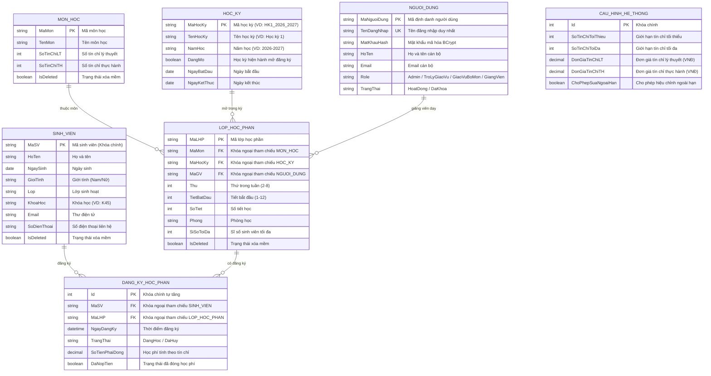

# Thiết Kế Cơ Sở Dữ Liệu & Sơ Đồ ERD

## 1. Sơ Đồ Quan Hệ Thực Thể (ERD)

Cơ sở dữ liệu được chuẩn hóa ở dạng chuẩn 3 (3NF), thiết lập các ràng buộc toàn vẹn khóa ngoại (Foreign Keys), chỉ mục tìm kiếm (Indexes) và cơ chế xóa mềm (Soft Delete).



---

## 2. Chi Tiết Các Bảng Dữ Liệu

### 2.1. Bảng `SinhVien` (Quản lý Hồ sơ Sinh viên)
* **Khóa chính:** `MaSV` (varchar, tối đa 20 ký tự).
* **Trường dữ liệu:** `HoTen`, `NgaySinh`, `GioiTinh`, `Lop`, `KhoaHoc`, `Email`, `SoDienThoai`.
* **Ràng buộc:** `MaSV` không rỗng, tự động chuẩn hóa chuỗi viết hoa khi nhập.
* **Audit fields:** `NgayTao`, `NgayCapNhat`, `IsDeleted` (xóa mềm).

### 2.2. Bảng `MonHoc` (Danh mục Môn học)
* **Khóa chính:** `MaMon` (varchar, tối đa 20 ký tự).
* **Trường dữ liệu:** `TenMon`, `SoTinChiLT`, `SoTinChiTH`.
* **Ràng buộc:** `SoTinChiLT >= 0`, `SoTinChiTH >= 0`, `(SoTinChiLT + SoTinChiTH) > 0`.
* **Cột tính toán:** `TongTinChi` = `SoTinChiLT + SoTinChiTH`.

### 2.3. Bảng `HocKy` (Học kỳ Đào tạo)
* **Khóa chính:** `MaHocKy` (varchar, tối đa 20 ký tự).
* **Trường dữ liệu:** `TenHocKy`, `NamHoc`, `DangMo` (chỉ 1 học kỳ được mang giá trị `true` tại một thời điểm), `NgayBatDau`, `NgayKetThuc`.

### 2.4. Bảng `LopHocPhan` (Lớp Học Phần Mở Trong Kỳ)
* **Khóa chính:** `MaLHP` (varchar, tối đa 30 ký tự).
* **Khóa ngoại:** `MaMon` trỏ về `MonHoc`, `MaHocKy` trỏ về `HocKy`, `MaGV` trỏ về `NguoiDung`.
* **Trường lịch học:** `Thu` (2-8), `TietBatDau` (1-12), `SoTiet` (1-6), `Phong`.
* **Sĩ số:** `SiSoToiDa` (int > 0). Sĩ số hiện tại được tính toán động dựa trên số bản ghi `DangKyHocPhan` có trạng thái `DangHoc`.

### 2.5. Bảng `DangKyHocPhan` (Phiếu Đăng Ký Học Phần)
* **Khóa chính:** `Id` (int, tự tăng).
* **Khóa ngoại:** `MaSV` trỏ về `SinhVien`, `MaLHP` trỏ về `LopHocPhan`.
* **Trạng thái:** `TrangThai` nhận 1 trong 2 giá trị chuẩn:
  * `DangHoc`: Đăng ký hợp lệ và đang theo học.
  * `DaHuy`: Đã thực hiện hủy đăng ký (không xóa cứng khỏi CSDL nhằm bảo toàn lịch sử giao dịch).
* **Tài chính:** `SoTienPhaiDong` (decimal), `DaNopTien` (boolean).

### 2.6. Bảng `NguoiDung` (Tài khoản Người dùng Hệ thống)
* **Khóa chính:** `MaNguoiDung`. Khóa duy nhất: `TenDangNhap`.
* **Bảo mật:** `MatKhauHash` sử dụng thuật toán băm chậm `BCrypt.Net-Next` với Salt ngẫu nhiên, ngăn chặn tấn công Rainbow Table.
* **Vai trò:** `Role` nhận 1 trong 4 giá trị enum: `Admin`, `TroLyGiaoVu`, `GiaoVuBoMon`, `GiangVien`.

### 2.7. Bảng `CauHinhHeThong` (Tham số Toàn Cục)
* Lưu trữ các tham số nghiệp vụ cấu hình động: `SoTinChiToiThieu` (mặc định 10), `SoTinChiToiDa` (mặc định 24), `DonGiaTinChiLT` (mặc định 350.000 VNĐ), `DonGiaTinChiTH` (mặc định 450.000 VNĐ).

---

## 3. Cơ Chế Audit & Xóa Mềm (Soft Delete)

Để bảo đảm tính toàn vẹn và khả năng kiểm toán dữ liệu:
* Các thực thể kế thừa giao diện `IAuditableEntity` (`NgayTao`, `NgayCapNhat`) và `ISoftDeleteEntity` (`IsDeleted`).
* Tầng EF Core tự động bắt sự kiện `SaveChangesAsync` để gán `NgayCapNhat = DateTime.UtcNow`.
* Các truy vấn mặc định áp dụng Global Query Filter:
```csharp
modelBuilder.Entity<SinhVien>().HasQueryFilter(e => !e.IsDeleted);
modelBuilder.Entity<MonHoc>().HasQueryFilter(e => !e.IsDeleted);
modelBuilder.Entity<LopHocPhan>().HasQueryFilter(e => !e.IsDeleted);
```
Khi xóa bản ghi, hệ thống chỉ cập nhật cờ `IsDeleted = true`, bảo đảm không bao giờ xảy ra tình trạng mất dữ liệu liên đới hoặc hỏng khóa ngoại lịch sử.
