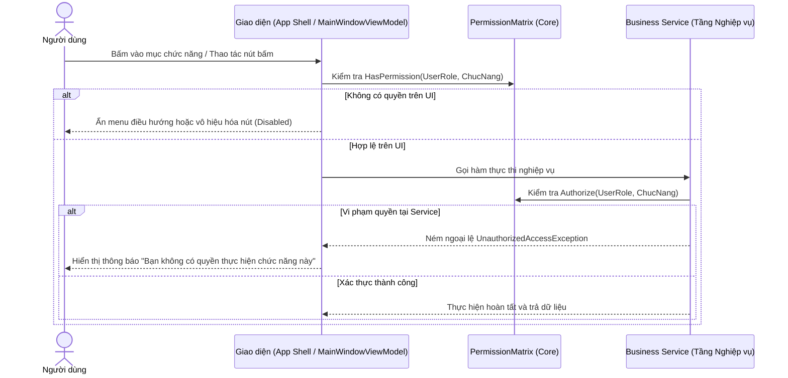

# Ma Trận Phân Quyền & Bảo Mật 4 Vai Trò

## 1. Định Danh 4 Vai Trò Trong Hệ Thống

Hệ thống thiết kế mô hình phân quyền dựa trên vai trò (Role-Based Access Control - RBAC) với 4 nhóm người dùng nội bộ, tương ứng với enum `UserRole`:

| ID | Enum Value | Tên Hiển Thị | Trách Nhiệm Chính |
|---|---|---|---|
| 0 | `Admin` | Quản trị viên hệ thống | Toàn quyền cấu hình tham số, quản trị tài khoản người dùng, giám sát toàn bộ hoạt động. |
| 1 | `TroLyGiaoVu` | Trợ lý giáo vụ Khoa | Quản lý hồ sơ sinh viên, danh mục môn học, tổ chức đăng ký học phần, lập danh sách thi, xuất báo cáo, nhập Excel. |
| 2 | `GiaoVuBoMon` | Giáo vụ bộ môn | Quản lý kế hoạch giảng dạy bộ môn, theo dõi sĩ số các lớp học phần, kiểm tra tình hình đăng ký của sinh viên. |
| 3 | `GiangVien` | Giảng viên | Tra cứu tổng quan Dashboard, xem danh sách sinh viên đăng ký và danh sách thi của các lớp học phần mình trực tiếp phụ trách. |

---

## 2. Bảng Ma Trận Phân Quyền Chi Tiết

Bảng dưới đây xác định thẩm quyền của từng vai trò đối với 15 chức năng nghiệp vụ định nghĩa tại `QuanLyDKHP.Core.Authorization.ChucNang`:

| Chức Năng Nghiệp Vụ | Admin | Trợ Lý Giáo Vụ | Giáo Vụ Bộ Môn | Giảng Viên |
|---|:---:|:---:|:---:|:---:|
| **Xác thực Đăng nhập** | [Cho phép] | [Cho phép] | [Cho phép] | [Cho phép] |
| **Xem Dashboard (Trang chủ)** | [Cho phép] | [Cho phép] | [Cho phép] | [Giới hạn lớp dạy] |
| **Quản lý Sinh viên (CRUD)** | [Cho phép] | [Cho phép] | [Cho phép] | [Không cho phép] |
| **Quản lý Môn học (CRUD)** | [Cho phép] | [Cho phép] | [Cho phép] | [Không cho phép] |
| **Học kỳ & Lớp học phần** | [Cho phép] | [Cho phép] | [Cho phép] | [Không cho phép] |
| **Đăng ký / Hủy học phần** | [Cho phép] | [Cho phép] | [Cho phép] | [Không cho phép] |
| **Thực thi Tính học phí** | [Cho phép] | [Cho phép] | [Cho phép] | [Không cho phép] |
| **Tra cứu Học phí** | [Cho phép] | [Cho phép] | [Cho phép] | [Chỉ xem] |
| **Xem DS SV đăng ký theo môn** | [Cho phép] | [Cho phép] | [Cho phép] | [Giới hạn lớp dạy] |
| **Lập danh sách thi** | [Cho phép] | [Cho phép] | [Cho phép] | [Giới hạn lớp dạy] |
| **In phiếu kết quả ĐKHP** | [Cho phép] | [Cho phép] | [Cho phép] | [Không cho phép] |
| **Báo cáo thống kê tổng hợp** | [Cho phép] | [Cho phép] | [Cho phép] | [Giới hạn phạm vi] |
| **Nhập dữ liệu Excel quy mô lớn** | [Cho phép] | [Cho phép] | [Không cho phép] | [Không cho phép] |
| **Cấu hình tham số hệ thống** | [Cho phép] | [Không cho phép] | [Không cho phép] | [Không cho phép] |
| **Quản lý người dùng & Đổi quyền** | [Cho phép] | [Không cho phép] | [Không cho phép] | [Không cho phép] |

---

## 3. Cơ Chế Kiểm Soát Thẩm Quyền Kép (Dual-Layer Authorization)

Để ngăn ngừa tối đa các nguy cơ tấn công leo thang đặc quyền (Privilege Escalation), hệ thống áp dụng cơ chế xác thực thẩm quyền kép:



### 3.1. Lớp 1: Kiểm soát hiển thị tại Giao diện (Presentation Layer)
* `MainWindowViewModel` khởi tạo danh sách menu điều hướng thông qua bộ lọc quyền:
```csharp
MenuItems = _allMenuItems
    .Where(item => PermissionMatrix.HasPermission(currentUser.Role, item.RequiredFunction))
    .ToList();
```
* Các chức năng người dùng không có quyền sẽ được ẩn hoàn toàn khỏi Sidebar và Top Bar, tránh gây nhầm lẫn giao diện.

### 3.2. Lớp 2: Kiểm soát bắt buộc tại Tầng Dịch vụ (Service Layer)
* Giao diện UI có thể bị giả lập hoặc gọi trực tiếp qua code test. Do đó, tất cả phương thức trong `QuanLyDKHP.Services` đều kiểm tra quyền hạn trước khi thao tác DB:
```csharp
PermissionMatrix.Authorize(_currentUserService.CurrentUser?.Role, ChucNang.CrudSinhVien);
```
* Nếu vai trò không thỏa mãn, phương thức ngay lập tức kích hoạt `UnauthorizedAccessException`, bảo vệ toàn vẹn logic nghiệp vụ ở mức mã máy.
