# F01 - Xác Thực & Đăng Nhập Hệ Thống

## 1. Mục Tiêu & Yêu Cầu Nghiệp Vụ

Chức năng xác thực đóng vai trò cửa ngõ an ninh của hệ thống, nhận diện danh tính và phân bổ đúng thẩm quyền cho 4 nhóm người dùng nội bộ: Quản trị viên (Admin), Trợ lý giáo vụ, Giáo vụ bộ môn và Giảng viên.

### Các yêu cầu cốt lõi
* **Bảo mật mật khẩu:** Tuyệt đối không lưu mật khẩu dạng bản rõ (plaintext). Mật khẩu được mã hóa một chiều bằng thuật toán `BCrypt` kết hợp Salt ngẫu nhiên.
* **Giao diện Split-Screen:** Giao diện đăng nhập hiện đại chia 2 phần (bên trái giới thiệu hệ thống, bên phải khung nhập liệu trực quan).
* **Kiểm tra trạng thái tài khoản:** Ngăn chặn ngay lập tức các tài khoản có trạng thái `DaKhoa` (Đã khóa) đăng nhập vào hệ thống.
* **Ghi nhớ đăng nhập an toàn:** Cho phép lưu tên tài khoản vào bộ nhớ cục bộ máy trạm (`LocalSessionStore`) để tiện đăng nhập lần sau. Không lưu mật khẩu trên ổ đĩa.
* **Trải nghiệm người dùng:** Hiệu ứng rung nhẹ (Shake Animation) khi nhập sai mật khẩu, spinner quay khi đang xác thực qua mạng và nút ẩn/hiện mật khẩu.

---

## 2. Luồng Xử Lý Nghiệp Vụ (Sequence Diagram)

```mermaid
sequenceDiagram
    actor User as Người dùng
    participant View as LoginWindow (Avalonia UI)
    participant VM as LoginViewModel
    participant Service as AuthService
    participant Repo as NguoiDungRepository
    participant DB as PostgreSQL Database

    User->>View: Nhập Tên đăng nhập & Mật khẩu -> Bấm "Đăng nhập"
    View->>VM: Thực thi DangNhapCommand
    VM->>VM: Bật cờ IsLoading = true (hiển thị spinner)
    VM->>Service: Goi AuthenticateAsync(username, password)
    Service->>Repo: LayTheoTenDangNhapAsync(username)
    Repo->>DB: Truy vấn bảng NguoiDung
    DB-->>Repo: Trả về thực thể NguoiDung
    Repo-->>Service: NguoiDung hoặc null

    alt Người dùng không tồn tại
        Service-->>VM: Trả về thất bại ("Tài khoản hoặc mật khẩu không chính xác")
        VM->>View: Kích hoạt hiệu ứng Shake + Báo lỗi đỏ
    else Tài khoản bị khóa (TrangThai == "DaKhoa")
        Service-->>VM: Trả về thất bại ("Tài khoản đã bị tạm khóa bởi Quản trị viên")
        VM->>View: Báo lỗi cảnh báo
    else Mật khẩu không khớp (BCrypt.Verify thất bại)
        Service-->>VM: Trả về thất bại ("Tài khoản hoặc mật khẩu không chính xác")
        VM->>View: Kích hoạt hiệu ứng Shake
    else Xác thực thành công
        Service-->>VM: Trả về thông tin UserSession (Id, TenDangNhap, Role, HoTen)
        VM->>VM: Lưu CurrentUser vào ICurrentUserService
        VM->>View: Đóng LoginWindow, khởi tạo và mở MainWindow
    end
    VM->>VM: Tắt cờ IsLoading = false
```

---

## 3. Các Tệp Mã Nguồn Triển Khai

* **Giao diện (UI):** `src/QuanLyDKHP.App/Views/LoginWindow.axaml` và `LoginWindow.axaml.cs`.
* **Mô hình điều khiển:** `src/QuanLyDKHP.App/ViewModels/LoginViewModel.cs`.
* **Tầng nghiệp vụ:** `src/QuanLyDKHP.Services/AuthService.cs`.
* **Tầng dữ liệu:** `src/QuanLyDKHP.Infrastructure/Repositories/NguoiDungRepository.cs`.
* **Lưu phiên cục bộ:** `src/QuanLyDKHP.App/Services/LocalSessionStore.cs`.
* **Kiểm thử tự động:** `tests/QuanLyDKHP.Tests/AuthServiceTests.cs`.
