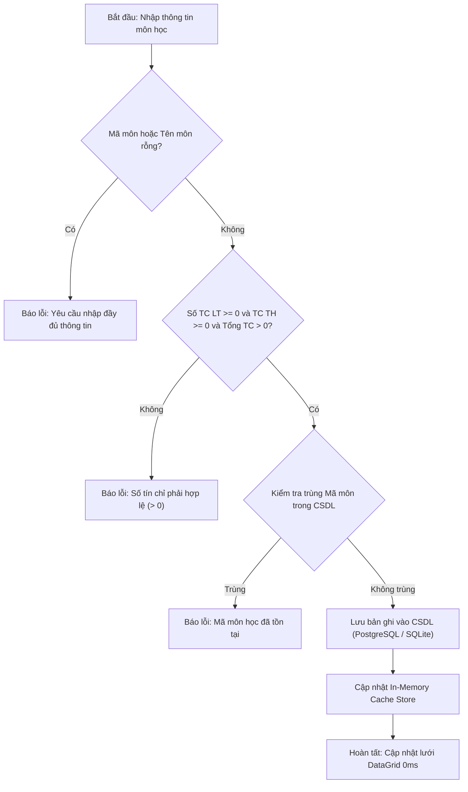

# F03 - Quản Lý Danh Mục Môn Học

## 1. Mục Tiêu & Yêu Cầu Nghiệp Vụ

Đáp ứng yêu cầu số 2 và số 7 trong đề bài môn học: Quản lý danh mục môn học đào tạo và sắp xếp danh sách môn học chuẩn xác theo thứ tự từ điển tiếng Việt.

### Các tính năng chính
1. **Quản lý thông tin chi tiết:** Mã môn học, Tên môn học, Số tín chỉ lý thuyết (LT), Số tín chỉ thực hành (TH).
2. **Tự động tái kích hoạt (Reactivate) sau Soft-Delete:** Nếu tạo lại môn học có `MaMon` trùng với môn đã từng xóa mềm, hệ thống tự động gỡ cờ xóa mềm (`IsDeleted = false`) và cập nhật số tín chỉ, tên môn mới mà không vi phạm ràng buộc UNIQUE.
3. **Tính toán tự động:** Thuộc tính `TongTinChi = SoTinChiLT + SoTinChiTH` được hệ thống tự động tính toán và hiển thị.
4. **Sắp xếp theo thứ tự từ điển tiếng Việt (Yêu cầu số 7):**
   * Sử dụng `StringComparer.Create(new CultureInfo("vi-VN"), false)` trong các thao tác LINQ OrderBy.
   * Đảm bảo các ký tự tiếng Việt đặc thù (ă, â, đ, ê, ô, ơ, ư...) được sắp xếp chính xác theo bảng chữ cái từ điển tiếng Việt A-Z hoặc Z-A.
5. **Bảo toàn dữ liệu & Chặn xóa:** Kiểm tra ràng buộc toàn vẹn khi xóa. Nếu môn học đã được sử dụng để mở Lớp học phần trong bất kỳ học kỳ nào, hệ thống sẽ chặn xóa cứng và chuyển sang trạng thái cảnh báo an toàn.
6. **Tiện ích sao chép mã môn:** Cho phép cán bộ giáo vụ bấm vào biểu tượng sao chép để đưa nhanh mã môn vào bộ nhớ tạm (Clipboard), phục vụ tìm kiếm liên màn hình.

---

## 2. Quy Trình Thêm & Cập Nhật Môn Học

---

## 3. Các Tệp Mã Nguồn Triển Khai

* **Giao diện:** `src/QuanLyDKHP.App/Views/MonHocView.axaml` và `MonHocView.axaml.cs`.
* **Hộp thoại chỉnh sửa:** `src/QuanLyDKHP.App/Views/MonHocEditDialog.axaml`.
* **ViewModel:** `src/QuanLyDKHP.App/ViewModels/MonHocViewModel.cs`.
* **Tầng nghiệp vụ & Repository:** `src/QuanLyDKHP.Services/MonHocService.cs` và `MonHocRepository.cs`.
* **Kiểm thử tự động:** `tests/QuanLyDKHP.Tests/SinhVienMonHocServiceTests.cs`.
