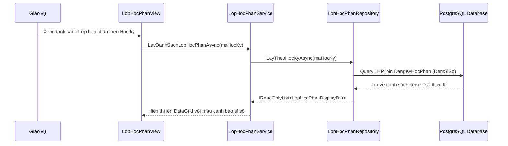

# F04 - Quản Lý Học Kỳ & Lớp Học Phần

## 1. Mục Tiêu & Yêu Cầu Nghiệp Vụ

Tổ chức cấu trúc thời gian đào tạo và mở các lớp học phần cụ thể cho từng kỳ học. Đây là dữ liệu nền tảng phục vụ toàn bộ quy trình đăng ký môn học và xếp thời khóa biểu.

### Các tính năng chính
1. **Quản lý Học kỳ Đào tạo:**
   * Khai báo thông tin học kỳ: Mã học kỳ (VD: `HK1_2026_2027`), Tên học kỳ, Năm học, Ngày bắt đầu, Ngày kết thúc.
   * **Cơ chế Đóng/Mở học kỳ linh hoạt:** Quản trị viên có thể kích hoạt mở học kỳ hiện hành hoặc chủ động đóng học kỳ kết thúc thông qua `HocKyService.CapNhatAsync(hocKy)` (cập nhật đồng bộ cờ `DangMo = false`).
   * **Quy tắc Duy nhất một học kỳ mở:** Hệ thống bảo đảm chỉ có duy nhất một học kỳ mang cờ `DangMo = true`. Khi giáo vụ kích hoạt mở một kỳ mới, phương thức `DatHocKyHienHanhAsync` sẽ tự động đóng toàn bộ các học kỳ còn lại.
   * **Đồng nhất định danh ComboBox (`IEquatable<HocKy>`):** Thực thể `HocKy` ghi đè phương thức `Equals` và `GetHashCode` dựa theo `MaHocKy`, đảm bảo các điều khiển `ComboBox` và bộ lọc dữ liệu nhận diện chính xác học kỳ đã chọn, không bị lỗi mất lựa chọn khi nạp lại cache.
2. **Quản lý Lớp học phần:**
   * Mở lớp học phần gắn liền với một môn học và học kỳ đang mở.
   * **Tự động tái kích hoạt sau Soft-Delete:** Phục hồi LHP đã bị xóa mềm nếu được tạo mới với cùng `MaLHP`.
   * **Chặn đổi Môn học khi đã có sinh viên đăng ký:** Trong `LopHocPhanService.CapNhatAsync`, nếu LHP đã phát sinh sinh viên đăng ký học phần, hệ thống chặn tuyệt đối thao tác đổi mã môn học (`MaMon`) để bảo vệ dữ liệu tín chỉ và học phí của sinh viên. Trên giao diện, ComboBox Môn học tự động bị vô hiệu hóa kèm ToolTip giải thích rõ lý do.
   * **Bảo vệ giới hạn sĩ số tối thiểu:** Không cho phép giáo vụ hạ sĩ số tối đa (`SiSoToiDa`) xuống thấp hơn số lượng sinh viên thực tế đang học trong lớp.
   * **Thống nhất nhận diện Giảng viên (`MaGV` vs `TenDangNhap`):** Phân công Giảng viên giảng dạy hỗ trợ đối soát linh hoạt qua cả `MaGV` và `TenDangNhap`, loại bỏ tình trạng hiển thị "Chưa phân công" do lệch mã định danh.
   * Thiết lập lịch học: Thứ trong tuần (Thứ 2 đến Chủ nhật), Tiết bắt đầu (1-12), Số tiết (1-6), Phòng học.
   * Thiết lập sĩ số tối đa (`SiSoToiDa`).
3. **Theo dõi Sĩ số Real-time:**
   * Tính toán sĩ số thực tế đang theo học (`TrangThai == DangHoc`).
   * Hiển thị tỷ lệ lấp đầy trực quan bằng thanh trạng thái 3 mức màu:
     * **Màu xanh lục:** Lớp còn nhiều chỗ trống (Dưới 70% sĩ số).
     * **Màu cam:** Lớp sắp đầy (Từ 70% đến 95% sĩ số).
     * **Màu đỏ:** Lớp đã đạt mức tối đa 100% hoặc vượt giới hạn.
4. **Bảo vệ tính toàn vẹn khi xóa:**
   * Ngăn chặn tuyệt đối việc xóa lớp học phần nếu đã có sinh viên đăng ký đang theo học.

---

## 2. Quy Trình Cập Nhật Sĩ Số Tự Động

---

## 3. Các Tệp Mã Nguồn Triển Khai

* **Giao diện:** `src/QuanLyDKHP.App/Views/HocKyLopHocPhanView.axaml` và `.axaml.cs`.
* **Hộp thoại chỉnh sửa:** `src/QuanLyDKHP.App/Views/LopHocPhanEditDialog.axaml`.
* **ViewModel:** `src/QuanLyDKHP.App/ViewModels/HocKyLopHocPhanViewModel.cs`.
* **Tầng nghiệp vụ & Repository:** `src/QuanLyDKHP.Services/LopHocPhanService.cs`, `HocKyService.cs`, `LopHocPhanRepository.cs`, `HocKyRepository.cs`.
* **SQL bổ sung lịch học:** `db/2026-10-01_them-lich-hoc-LopHocPhan.sql`.
