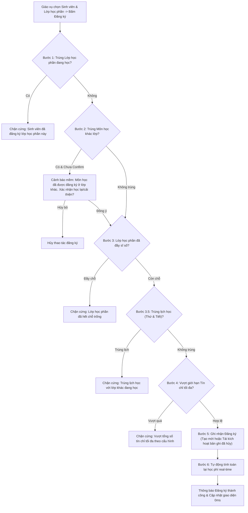

# F05 - Đăng Ký & Điều Chỉnh Học Phần

## 1. Mục Tiêu & Yêu Cầu Nghiệp Vụ

Đáp ứng yêu cầu số 3 trong đề bài môn học: Đây là phân hệ trung tâm và phức tạp nhất của dự án, quản lý luồng đăng ký môn học cho sinh viên dưới sự giám sát của giáo vụ, thực thi các thuật toán kiểm tra ràng buộc đào tạo nghiêm ngặt và đồng bộ học phí tức thì.

---

## 2. Quy Trình Xác Thực 6 Bước Tuần Tự (6-Step Validation Pipeline)

Mỗi lượt đăng ký được thực thi qua phương thức `DangKyHocPhanService.DangKyAsync`, vượt qua 6 chốt chặn logic:

### Chi tiết các bước kiểm tra
1. **Kiểm tra trùng Lớp học phần (Chặn cứng):** Kiểm tra xem sinh viên đã có bản ghi đăng ký LHP này với trạng thái `DangHoc` trong học kỳ hay chưa. Nếu có, báo lỗi từ chối ngay lập tức.
2. **Kiểm tra trùng Môn học (Cảnh báo mềm):** Trường hợp sinh viên đã đăng ký một lớp khác của cùng môn học này, hệ thống bật hộp thoại thông báo: *"Sinh viên đã đăng ký môn học này ở lớp học phần [Mã LHP]. Bạn có chắc chắn muốn đăng ký lớp mới (học lại/học cải thiện) không?"*. Chỉ khi giáo vụ xác nhận tiếp tục, luồng xử lý mới đi tiếp.
3. **Kiểm tra Sĩ số tối đa (Chặn cứng):** Lấy số lượng bản ghi `DangHoc` thực tế. Nếu `SiSoHienTai >= SiSoToiDa`, hệ thống từ chối ghi nhận để bảo đảm quy mô lớp học.
4. **Kiểm tra Trùng lịch học (Bước 3.5 - Chặn cứng):** So sánh Thứ và khoảng tiết `[TietBatDau, TietBatDau + SoTiet - 1]` của LHP đang đăng ký với tất cả các LHP mà sinh viên đang học. Nếu phát hiện giao nhau, hệ thống trả về thông báo lỗi chi tiết nêu rõ tên môn và khoảng tiết bị xung đột.
5. **Kiểm tra Giới hạn Tín chỉ (Chặn cứng):** Tổng số tín chỉ đang học cộng với số tín chỉ của môn mới không được vượt quá tham số `SoTinChiToiDa` (quy định tại bảng cấu hình hệ thống).
6. **Lưu bản ghi & Kích hoạt tính học phí:** 
   * Nếu sinh viên chưa từng đăng ký: Tạo mới bản ghi `DangKyHocPhan` với `TrangThai = DangHoc`.
   * Nếu sinh viên từng đăng ký rồi hủy trước đó: Tái kích hoạt bản ghi cũ, chuyển `TrangThai = DangHoc` nhằm bảo toàn khóa chính.
   * Kích hoạt tự động dịch vụ `HocPhiService.TinhLaiHocPhiAsync` để cập nhật tổng tiền phải đóng.

---

## 3. Quy Trình Hủy Đăng Ký Học Phần (Soft Cancel)

Khi sinh viên muốn rút bớt học phần:
* Hệ thống **không xóa cứng bản ghi** khỏi CSDL để lưu lại vết lịch sử giao dịch đào tạo.
* Trạng thái bản ghi được chuyển thành `TrangThai = DaHuy`.
* Sĩ số lớp học phần tự động giảm đi 1 chỗ trống cho sinh viên khác.
* Học phí của học phần đó được khấu trừ tức thì khỏi tổng học phí sinh viên phải nộp.

---

## 4. Các Tệp Mã Nguồn Triển Khai

* **Giao diện:** `src/QuanLyDKHP.App/Views/DangKyHocPhanView.axaml` và `.axaml.cs`.
* **ViewModel:** `src/QuanLyDKHP.App/ViewModels/DangKyHocPhanViewModel.cs`.
* **Tầng nghiệp vụ:** `src/QuanLyDKHP.Services/DangKyHocPhanService.cs`.
* **Tầng dữ liệu:** `src/QuanLyDKHP.Infrastructure/Repositories/DangKyHocPhanRepository.cs`.
* **Kiểm thử tự động:** `tests/QuanLyDKHP.Tests/DangKyHocPhanServiceTests.cs` (Đạt 9/9 test cases bao phủ toàn diện 6 bước kiểm tra).
