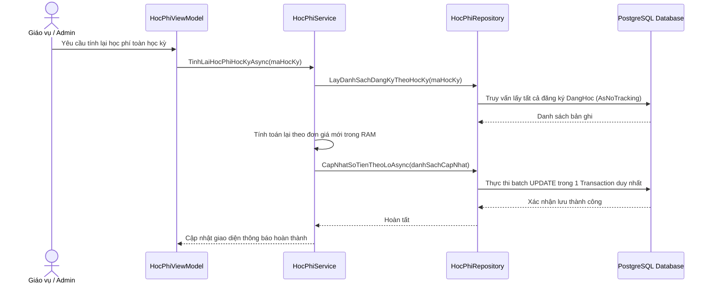

# F06 - Quản Lý & Tính Toán Học Phí

## 1. Mục Tiêu & Yêu Cầu Nghiệp Vụ

Đáp ứng yêu cầu số 4 trong đề bài môn học: Xây dựng cơ chế tính toán học phí tự động, chính xác theo định mức tín chỉ lý thuyết và thực hành, hỗ trợ đa dạng góc nhìn tra cứu và xuất hóa đơn chứng từ chuẩn in ấn.

### Công thức tính học phí chuẩn (Đồng nhất 100% giữa Danh sách & Chi tiết)
Học phí của sinh viên trong một học kỳ được tính tổng từ tất cả các lớp học phần sinh viên đang theo học (`TrangThai = DangHoc`):

```text
Tổng Học Phí = Tổng các môn [ SoTienPhaiDong (nếu có định mức riêng) HOẶC (SoTinChiLT * DonGiaLT + SoTinChiTH * DonGiaTH) ]
Còn Nợ = Tổng Học Phí - Đã Đóng
Trạng Thái = Đã đóng đủ (nếu Còn Nợ <= 0) / Còn nợ (nếu Còn Nợ > 0)
```

Trong đó:
* `DonGiaLT` và `DonGiaTH` được quản lý động tại bảng `CauHinhHeThong` (mặc định: 500.000 VNĐ / tín chỉ LT; 700.000 VNĐ / tín chỉ TH).
* Nếu bản ghi `DangKyHocPhan` đã mang giá trị `SoTienPhaiDong` cụ thể (ví dụ: học phí định mức import từ Excel hoặc môn đặc thù), hệ thống ưu tiên sử dụng `SoTienPhaiDong`.
* Các học phần có trạng thái `DaHuy` (đã hủy) tự động được loại trừ khỏi công thức tính tiền.
* **Cơ chế hiển thị học phí kỳ đã đóng:** Đối với học kỳ đã đóng (`DangMo = false`), nếu chưa có bản ghi snapshot khóa sổ (`HocPhiHocKy`), hệ thống tự động fallback tính toán trực tiếp từ các đăng ký học phần thực tế của kỳ đó. Đảm bảo dữ liệu học phí của các kỳ đã kết thúc không bao giờ bị trả về 0đ.
* **Thống nhất tuyệt đối dữ liệu:** Màn hình danh sách tổng hợp (`GetHocPhiTheoDanhSachLocalAsync`) và modal chi tiết từng sinh viên (`TinhHocPhiSinhVienAsync`) dùng chung một công thức tính, loại bỏ hoàn toàn tình trạng số tiền hiển thị trên danh sách khác với khi bấm xem chi tiết.

---

## 2. Các Chế Độ Tra Cứu Linh Hoạt
Màn hình Quản lý học phí cung cấp 3 phạm vi lọc dữ liệu:

1. **Tra cứu theo Sinh viên:** Nhập mã số hoặc họ tên sinh viên (có bộ lọc gợi ý nhanh). Hiển thị chi tiết bảng kê các môn học đăng ký, số tiền từng môn, chức năng nộp tiền trực tiếp và xuất phiếu thu PDF.
2. **Tra cứu theo Lớp sinh hoạt:** Thống kê tổng hợp tình hình nợ học phí của toàn bộ một lớp sinh hoạt trong khoa.
3. **Tra cứu theo Khóa học:** Báo cáo tổng thể nguồn thu học phí theo từng khóa đào tạo (K44, K45, K46...).

---

## 3. Chức Năng Ghi Nhận Nộp Tiền Học Phí (Payment Processing)

Nhằm phục vụ nghiệp vụ thu học phí tại phòng kế toán/giáo vụ:
* **Phương thức thực thi:** `IHocPhiService.GhiNhanNopTienAsync(maSV, maHocKy, soTienNop)`.
* **Giao diện thao tác:** Hỗ trợ nút thao tác nhanh "Ghi nhận nộp tiền" trực tiếp tại từng dòng sinh viên trên bảng tổng hợp, đồng thời có nút nộp tiền ngay trong màn hình xem chi tiết học phí.
* **Quy tắc phân bổ số tiền nộp:**
  1. Tiền nộp được tự động khấu trừ lần lượt cho các môn học phần còn thiếu tiền (`phaiDong - daDong > 0`) trong học kỳ.
  2. Cập nhật trường `SoTienDaDong` xuống CSDL thông qua `CapNhatSoTienDaDongAsync`.
  3. Nếu sinh viên nộp vượt quá tổng số tiền nợ của kỳ, phần dư sẽ được bảo toàn và cộng dồn vào lớp học phần đầu tiên.
  4. Sau khi ghi nhận thành công, giao diện tự động làm mới tổng học phí, số tiền đã đóng và trạng thái badge ("Đã đóng đủ" / "Còn nợ") tức thì mà không cần tải lại trang.

---

## 4. Quy Trình Tính Lại Học Phí Theo Lô (Batch Recalculation)

Khi người dùng thực hiện các thao tác thay đổi đơn giá tín chỉ trong Cấu hình hệ thống, hoặc sau khi hoàn tất quy trình Import Excel hàng nghìn sinh viên:



:::tip[Tối ưu hiệu năng]
Thuật toán tính toán theo lô (Batch Processing) gom hàng nghìn bản ghi để cập nhật trong một lệnh giao dịch duy nhất thay vì thực hiện $N$ lần truy vấn độc lập, giảm thời gian xử lý từ vài phút xuống còn **dưới 1 giây**.
:::

---

## 4. Các Tệp Mã Nguồn Triển Khai

* **Giao diện:** `src/QuanLyDKHP.App/Views/HocPhiView.axaml` và `.axaml.cs`.
* **ViewModel:** `src/QuanLyDKHP.App/ViewModels/HocPhiViewModel.cs`.
* **Tầng nghiệp vụ & Repository:** `src/QuanLyDKHP.Services/HocPhiService.cs` và `HocPhiRepository.cs`.
* **Xuất phiếu PDF:** `src/QuanLyDKHP.Infrastructure/Export/QuestPdfExportService.cs`.
* **Kiểm thử tự động:** `tests/QuanLyDKHP.Tests/HocPhiServiceTests.cs`.
