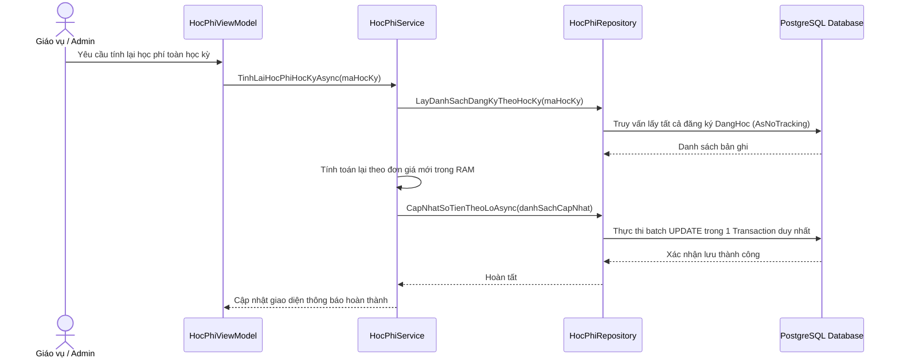

# F06 - Quản Lý & Tính Toán Học Phí

## 1. Mục Tiêu & Yêu Cầu Nghiệp Vụ

Đáp ứng yêu cầu số 4 trong đề bài môn học: Xây dựng cơ chế tính toán học phí tự động, chính xác theo định mức tín chỉ lý thuyết và thực hành, hỗ trợ đa dạng góc nhìn tra cứu và xuất hóa đơn chứng từ chuẩn in ấn.

### Công thức tính học phí chuẩn
Học phí của sinh viên trong một học kỳ được tính tổng từ tất cả các lớp học phần sinh viên đang theo học (`TrangThai = DangHoc`):

```text
Tổng Học Phí = Tổng các môn [ (SoTinChiLT * DonGiaLT) + (SoTinChiTH * DonGiaTH) ]
```

Trong đó:
* `DonGiaLT` và `DonGiaTH` được quản lý động tại bảng `CauHinhHeThong` (mặc định: 350.000 VNĐ / tín chỉ LT; 450.000 VNĐ / tín chỉ TH).
* Các học phần có trạng thái `DaHuy` (đã hủy) tự động được loại trừ khỏi công thức tính tiền.

---

## 2. Các Chế Độ Tra Cứu Linh Hoạt

Màn hình Quản lý học phí cung cấp 3 phạm vi lọc dữ liệu:

1. **Tra cứu theo Sinh viên:** Nhập mã số hoặc họ tên sinh viên (có bộ lọc gợi ý nhanh). Hiển thị chi tiết bảng kê các môn học đăng ký, số tiền từng môn và nút in phiếu thu PDF.
2. **Tra cứu theo Lớp sinh hoạt:** Thống kê tổng hợp tình hình nợ học phí của toàn bộ một lớp sinh hoạt trong khoa.
3. **Tra cứu theo Khóa học:** Báo cáo tổng thể nguồn thu học phí theo từng khóa đào tạo (K44, K45, K46...).

---

## 3. Quy Trình Tính Lại Học Phí Theo Lô (Batch Recalculation)

Khi người dùng thực hiện các thao tác thay đổi đơn giá tín chỉ trong Cấu hình hệ thống, hoặc sau khi hoàn tất quy trình Import Excel hàng nghìn sinh viên:



:::tip[Tối ưu hiệu năng]
Thuật toán tính toán theo lô (Batch Processing) gom hàng nghìn bản ghi để cập nhật trong một lệnh giao dịch duy nhất thay vì thực hiện $N$ lần truy vấn độc lập, giảm thời gian xử lý từ vài phút xuống còn **dưới 1 giây**.
:::

---

## 4. Các Tệp Mã Nguồn Triển Khai

* **Giao diện:** `src/QuanLyDKHP.App/Views/HocPhiView.axaml` và `.axaml.cs`.
* **ViewModel:** `src/QuanLyDKHP.App/ViewModels/HocPhiViewModel.cs`.
* **Tầng nghiệp vụ & Repository:** `src/QuanLyDKHP.Services/HocPhiService.cs` và `HocPhiRepository.cs`.
* **Xuất phiếu PDF:** `src/QuanLyDKHP.Infrastructure/Export/QuestPdfExportService.cs`.
* **Kiểm thử tự động:** `tests/QuanLyDKHP.Tests/HocPhiServiceTests.cs`.
