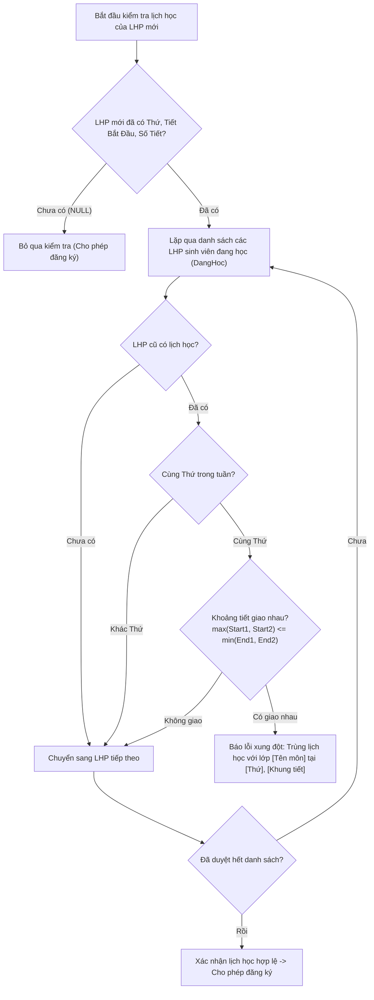

# F07 - Thời Khóa Biểu & Phát Hiện Trùng Lịch

## 1. Mục Tiêu & Yêu Cầu Nghiệp Vụ

Thời khóa biểu đồ họa là một trong những tính năng mở rộng có giá trị thực tiễn cao của đề tài. Tính năng này cho phép cán bộ giáo vụ và sinh viên có cái nhìn trực quan, tổng thể về lịch sinh hoạt học tập trong tuần, đồng thời tự động hóa hoàn toàn khâu phát hiện và ngăn ngừa xung đột lịch học (trùng tiết).

---

## 2. Giao Diện Lưới Thời Khóa Biểu 7 Cột (Weekly Schedule Grid)

Hộp thoại thời khóa biểu (`ThoiKhoaBieuDialog`) được mở trực tiếp từ màn hình Đăng ký học phần khi một sinh viên đã được chọn:

* **Cấu trúc lưới:** Gồm 7 cột tương ứng từ **Thứ 2 đến Chủ nhật**.
* **Hiển thị thông tin từng tiết học:** Mỗi ô lớp học phần hiển thị đầy đủ:
  * Tên môn học
  * Mã lớp học phần
  * Phòng học (nếu đã phân bổ)
  * Khung thời gian: `Tiết {TietBatDau} - {TietKetThuc}`
* **Xử lý lớp chưa xếp lịch:** Những lớp học phần chưa được phân công phòng hoặc thời gian học (`Thu`/`TietBatDau`/`SoTiet` mang giá trị `null`) sẽ không vẽ khống lên lưới mà được gom hiển thị ở danh mục riêng: *"Danh sách lớp chưa xếp lịch (chờ công bố)"*. Điều này tuân thủ nguyên tắc không tạo dữ liệu giả lập.
* **Tối ưu hiệu năng 0ms:** Dữ liệu thời khóa biểu được dựng trực tiếp từ danh sách các môn đã đăng ký sẵn có trong bộ nhớ RAM của `DangKyHocPhanViewModel`, không cần thực hiện thêm bất kỳ câu truy vấn cơ sở dữ liệu nào.

---

## 3. Thuật Toán Ngăn Ngừa Trùng Lịch Học

Khi thực hiện đăng ký một lớp học phần mới cho sinh viên, phương thức `DangKyHocPhanService.DangKyAsync` kích hoạt thuật toán kiểm tra giao nhau giữa các khoảng thời gian học:



### Công thức phát hiện giao nhau
Hai lớp học phần có lịch học giao nhau nếu và chỉ nếu chúng diễn ra trong cùng một Thứ và thỏa mãn điều kiện:

```text
max(TietBatDau_1, TietBatDau_2) <= min(TietKetThuc_1, TietKetThuc_2)
```

Trong đó: `TietKetThuc = TietBatDau + SoTiet - 1`.

Khi điều kiện trên xảy ra, hệ thống từ chối đăng ký và trả về thông báo lỗi chi tiết, giúp người dùng dễ dàng chọn lớp khác phù hợp hơn.

---

## 4. Các Tệp Mã Nguồn Triển Khai

* **Giao diện hộp thoại:** `src/QuanLyDKHP.App/Views/ThoiKhoaBieuDialog.axaml` và `.axaml.cs`.
* **ViewModel:** `src/QuanLyDKHP.App/ViewModels/ThoiKhoaBieuDialogViewModel.cs`.
* **Thuật toán kiểm tra:** Triển khai tại `src/QuanLyDKHP.Services/DangKyHocPhanService.cs`.
