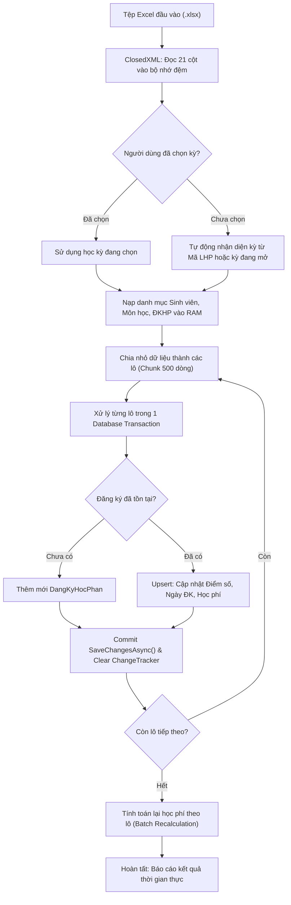

# F09 - Nhập Dữ Liệu Lớn Từ Excel (ClosedXML & Chuẩn Hóa 21 Cột)

## 1. Mục Tiêu & Yêu Cầu Nghiệp Vụ

Trong thực tế vận hành đầu mỗi năm học, các trường đại học tiếp nhận danh sách hàng nghìn sinh viên trúng tuyển và kế hoạch mở lớp theo từng kỳ. Thao tác nhập liệu thủ công trên giao diện từng dòng là bất khả thi.

Chức năng **Import Excel Thông Minh** được phát triển nhằm:
* Tiếp nhận và phân tích tệp Excel (`.xlsx`) chứa hàng nghìn dòng dữ liệu đào tạo chuẩn 21 cột.
* **Cơ chế Một Chạm (One-Click Import):** Người dùng chỉ cần đưa tệp Excel vào là hệ thống tự động đọc và nạp ngay, **không bắt buộc** phải chọn học kỳ đích trước. Hệ thống tự động suy luận học kỳ từ dữ liệu hoặc học kỳ đang mở.
* Tự động nhận diện thực thể và thực hiện cơ chế **Upsert** (Cập nhật nếu đã tồn tại, Thêm mới nếu chưa có) đồng thời cho: Sinh viên, Môn học, Học kỳ, Lớp học phần và Đăng ký học phần.
* **Bảo toàn 100% lịch sử ngày đăng ký:** Chuẩn hóa chuỗi thời gian tiếng Việt định dạng `SA` (Sáng) / `CH` (Chiều) sang UTC chính xác.
* Đảm bảo tính toàn vẹn, hiệu năng cao và cơ chế cách ly lỗi (Fault Isolation).

---

## 2. Đặc Tả Cấu Trúc 21 Cột File Mẫu

| Cột | Tên Cột | Kiểu Dữ Liệu | Mô Tả & Xử Lý Hệ Thống |
|:---:|---|---|---|
| **1** | Mã SV | Text (20) | Định danh duy nhất sinh viên |
| **2** | Tên SV | Text (100) | Họ và tên sinh viên |
| **3** | Lớp sinh hoạt | Text (30) | Lớp quản lý hành chính (VD: CTK45A) |
| **4** | Khóa Học | Text (20) | Khóa nhập học (VD: Khóa 45) |
| **5** | Mã môn | Text (20) | Mã định danh môn học |
| **6** | Tên môn | Text (150) | Tên môn học chi tiết |
| **7** | Mã LHP | Text (30) | Mã lớp học phần (chứa tiền tố học kỳ, VD: `26120CT4201D02`) |
| **8** | Số TC | Số nguyên | Tổng số tín chỉ của môn học |
| **9** | Mã GV | Text (20) | Mã định danh giảng viên |
| **10** | Tên GV | Text (100) | Họ tên giảng viên (tự động liên kết `MaGV` nếu cột 9 để trống) |
| **11** | Bậc ĐT | Text (10) | Bậc đào tạo (Đại học, Cao đẳng...) |
| **12** | Loại Hình ĐT | Text (10) | Loại hình đào tạo (Chính quy, Vừa học vừa làm...) |
| **13** | Hình Thức ĐK | Text (10) | Hình thức đăng ký (NKH: Nguyện vọng, HL: Học lại...) |
| **14** | Ngày ĐK | Date/Text | Ngày giờ đăng ký (hỗ trợ định dạng `dd/MM/yyyy h:mm:ss SA/CH`) |
| **15** | Người ĐK | Text (50) | Tài khoản/người thực hiện đăng ký |
| **16** | Điểm số | Số thập phân | Điểm tổng kết hệ 10 (0.00 – 10.00) |
| **17** | Điểm chữ | Text (5) | Điểm quy đổi (A, B, C, D, F...) |
| **18** | T/Trạng học phí | Text (50) | Tình trạng tính phí từ phòng đào tạo |
| **19** | Đã đóng | Số tiền | Số tiền sinh viên đã thanh toán |
| **20** | Phải đóng | Số tiền | Mức học phí phải nộp theo quy định |
| **21** | Giảng dạy Online | Text | Đánh dấu lớp dạy trực tuyến |

---

## 3. Kiến Trúc Xử Lý Theo Lô (Batch Processing) & Cơ Chế Upsert

### Các nguyên tắc kỹ thuật cốt lõi
1. **Chuẩn Hóa Ngày Tiếng Việt (`SA`/`CH`):** Sử dụng biểu thức chính quy chuẩn hóa `SA` $\rightarrow$ `AM` và `CH` $\rightarrow$ `PM`, kết hợp mảng định dạng `DateTime.TryParseExact` chuyển đổi sang UTC chính xác, không để rơi vào fallback `DateTime.UtcNow`.
2. **Cơ Chế Upsert Khi Re-import:** Khi nạp lại file chứa điểm thi hoặc trạng thái học phí mới, hệ thống so sánh và cập nhật trực tiếp vào bản ghi `DangKyHocPhan` đã có mà không gây trùng lặp khóa.
3. **Phòng Chống Lỗi Lan Truyền (Fault Isolation):** Nếu 1 dòng gặp lỗi (vượt độ dài cột, sai định dạng điểm), hệ thống ghi vào log chi tiết và thử lại từng dòng để cô lập dòng xấu, các dòng hợp lệ còn lại trong lô vẫn được lưu thành công.
4. **Quản Lý Bộ Nhớ & Change Tracker:** Đặt `AutoDetectChangesEnabled = false` và thực thi `ChangeTracker.Clear()` sau mỗi 500 dòng, giữ mức tiêu hao RAM luôn dưới 150MB ngay cả với tập tin hàng trăm nghìn dòng.

---

## 4. Các Tệp Mã Nguồn Triển Khai

* **Giao diện:** `src/QuanLyDKHP.App/Views/ImportExcelView.axaml` và `.axaml.cs`.
* **ViewModel:** `src/QuanLyDKHP.App/ViewModels/ImportExcelViewModel.cs`.
* **Tầng hạ tầng & Repository:** `src/QuanLyDKHP.Infrastructure/Repositories/ImportExcelRepository.cs`.
* **Dịch vụ & Interface:** `src/QuanLyDKHP.Services/ImportExcelService.cs`, `src/QuanLyDKHP.Core/Interfaces/IImportExcelRepository.cs`.
* **Script tạo dữ liệu thử nghiệm:** `scripts/generate_sample_excel.py`.
* **Kiểm thử tự động:** `tests/QuanLyDKHP.Tests/ImportExcelServiceTests.cs`, `tests/QuanLyDKHP.Tests/Nhom1ExcelHocKyTests.cs`.
