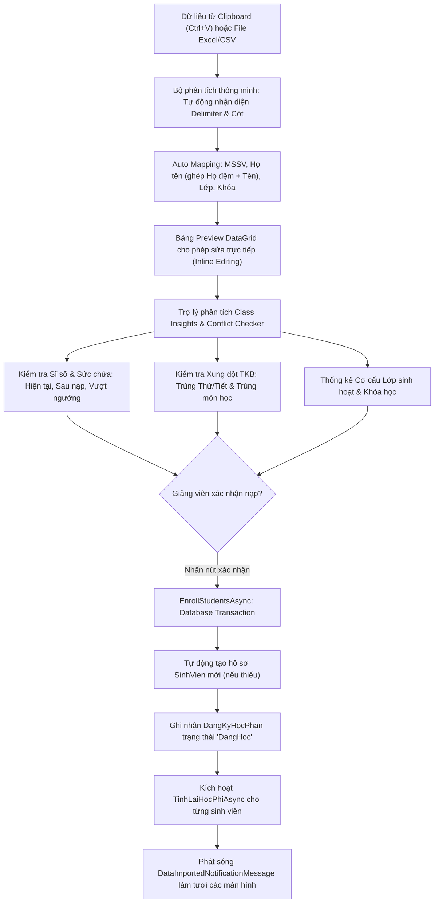

# F09 - Nhập Dữ Liệu & Smart Import Studio (Dán Clipboard, Phân Tích Xung Đột & File 21 Cột)

## 1. Giới Thiệu & Bối Cảnh Thực Tế

Trong môi trường giảng dạy đại học, ngoài việc phòng đào tạo nhập tệp lớn 21 cột định kỳ đầu năm, **giảng viên và giáo viên bộ môn** thường xuyên có nhu cầu thực tế:
- Nhận danh sách sinh viên lớp học phần bổ sung từ Excel, Google Sheets, email hoặc nhóm Zalo.
- Cần nạp nhanh danh sách này vào lớp học phần mình phụ trách mà **không muốn tốn thời gian căn chỉnh cột phức tạp** hay tạo lại file 21 cột.
- Cần biết ngay: **Lớp có bị quá tải không?** Có sinh viên nào bị **trùng lịch học** ca khác hay **đã đăng ký cùng môn** ở lớp khác không?
- Muốn sửa nhanh lỗi chính tả, sai MSSV **trực tiếp trên bảng xem trước** mà không cần mở lại file Excel gốc.

Nhằm giải quyết trọn vẹn bài toán thực tế này, hệ thống cung cấp giao diện 2 phân hệ hoàn chỉnh:
1. **🌟 Tab 1 - Nạp Sinh Viên Vào Lớp (Smart Import Studio & Class Insights):** Dành riêng cho giảng viên/giáo vụ thao tác nhanh từng lớp học phần bằng **Copy-Paste từ Clipboard (`Ctrl + V`)**, tự động ánh xạ cột, kiểm chứng xung đột và chỉnh sửa inline.
2. **🏢 Tab 2 - Nạp File 21 Cột Toàn Trường (Universal Batch Import):** Xử lý tệp Excel lớn quy mô trường học với cơ chế phân lô 500 dòng/lần, upsert đồng bộ và lưu trữ an toàn.

---

## 2. Phân Hệ 1: Smart Import Studio & Trợ Lý Xung Đột Lớp Học (Upgrade 1)

### 2.1. Dán Trực Tiếp Từ Bộ Nhớ Tạm (Clipboard Paste `Ctrl + V`)
* Giảng viên chỉ cần bôi đen danh sách MSSV và Họ tên trên Excel, Google Sheets, danh sách điểm danh Zalo rồi nhấn `Ctrl + C`.
* Chuyển vào ứng dụng, bấm nút **"Dán từ Clipboard (Ctrl + V)"**. Hệ thống tự động bóc tách các dòng và các ô dựa trên ký tự ngăn cách: Tab (`\t`), Phẩy (`,`), Chấm phẩy (`;`), hoặc dấu xuống dòng.
* Tự động nhận diện dòng tiêu đề hoặc suy luận thông minh khi người dùng dán dữ liệu thô không có header:
  - Nếu có cột "Họ đệm" và "Tên", hệ thống tự động ghép lại thành "Họ và tên" đầy đủ chuẩn tiếng Việt.
  - Tự động suy luận Khóa học (`K45`, `K46`, `K47`...) từ 2 chữ số đầu của MSSV (VD: `2100011` $\rightarrow$ `K21` hoặc `K45`).

### 2.2. Trợ Lý Trực Quan Class Insights & Phát Hiện Xung Đột (Đề Xuất 3)
Ngay khi danh sách được nạp vào, giao diện hiển thị 4 bảng thẻ trực quan:
1. **Sĩ số & Sức chứa:** Hiển thị sĩ số hiện tại, sĩ số dự kiến sau khi nạp, tỷ lệ lấp đầy lớp (ProgressBar) và cảnh báo đỏ nếu vượt quá `SiSoToiDa`.
2. **Kiểm tra Hợp lệ:** Phân tách rõ ràng số lượng sinh viên hợp lệ sẵn sàng nạp, số sinh viên đã có trong lớp (tự động bỏ chọn tránh trùng lặp) và số dòng lỗi/thiếu thông tin.
3. **Cảnh báo Xung đột TKB & Trùng môn:**
   - **Xung đột lịch học:** Tự động đối chiếu với toàn bộ thời khóa biểu các lớp khác của sinh viên trong cùng học kỳ. Nếu trùng `Thu` và khoảng tiết `[TietBatDau, TietBatDau + SoTiet - 1]` giao nhau, hệ thống gắn huy hiệu màu vàng cam và thông báo chi tiết mã lớp học phần bị trùng.
   - **Trùng môn học:** Phát hiện sinh viên đã đăng ký một lớp học phần khác của cùng môn học này trong kỳ.
4. **Cơ cấu Lớp & Khóa học:** Liệt kê tỷ lệ phân bổ sinh viên theo lớp sinh hoạt (VD: `CTK45A`, `CTK45B`) và khóa học để giảng viên nắm rõ đặc điểm người học trong lớp.

### 2.3. Chỉnh Sửa Trực Tiếp Trên Bảng Xem Trước (Inline Editing)
* Bảng DataGrid cho phép giảng viên nhấp chuột trực tiếp vào các ô `Mã Sinh Viên`, `Họ và Tên`, `Lớp Sinh Hoạt`, `Khóa Học` để gõ sửa lỗi sai ngay tại chỗ mà không cần xuất/mở lại file Excel.
* Nút **"🔄 Kiểm chứng lại"** cho phép tính toán lại các chỉ số ngay tức thì sau khi người dùng sửa lỗi.

### 2.4. Nạp Sinh Viên Đồng Thời & Tính Lại Học Phí Tự Động
* Thực thi trong 1 `Database Transaction` an toàn:
  - Nếu tùy chọn *"Tự động tạo hồ sơ sinh viên"* được chọn, hệ thống tự động khởi tạo hồ sơ `SinhVien` trong danh mục toàn trường nếu mã SV chưa từng xuất hiện.
  - Tự động phục hồi các bản ghi sinh viên hoặc đăng ký đã bị xóa mềm trước đó.
  - Sau khi nạp đăng ký thành công, hệ thống tự động kích hoạt tính toán lại học phí qua `IHocPhiService.TinhLaiHocPhiAsync` cho toàn bộ sinh viên được nạp.
  - Phát sóng thông báo `DataImportedNotificationMessage` qua MediatR/CommunityToolkit Messenger để làm tươi thời gian thực danh sách lớp ở tab *Học kỳ / LHP*, *Đăng ký học phần* và *Học phí*.

---

## 3. Phân Hệ 2: Nạp File 21 Cột Toàn Trường (Universal Batch Import)

Dành cho phòng đào tạo hoặc giáo vụ xử lý tập tin lớn toàn trường:

| Cột | Tên Cột | Kiểu Dữ Liệu | Mô Tả & Xử Lý Hệ Thống |
|:---:|---|---|---|
| **1** | Mã SV | Text (20) | Định danh duy nhất sinh viên |
| **2** | Tên SV | Text (100) | Họ và tên sinh viên |
| **3** | Lớp sinh hoạt | Text (30) | Lớp quản lý hành chính (VD: CTK45A) |
| **4** | Khóa Học | Text (20) | Khóa nhập học (VD: Khóa 45) |
| **5** | Mã môn | Text (20) | Mã định danh môn học |
| **6** | Tên môn | Text (150) | Tên môn học chi tiết |
| **7** | Mã LHP | Text (30) | Mã lớp học phần (VD: `26120CT4201D02`) |
| **8** | Số TC | Số nguyên | Tổng số tín chỉ của môn học |
| **9** | Mã GV | Text (20) | Mã định danh giảng viên |
| **10** | Tên GV | Text (100) | Họ tên giảng viên |
| **11** | Bậc ĐT | Text (10) | Bậc đào tạo (Đại học, Cao đẳng...) |
| **12** | Loại Hình ĐT | Text (10) | Loại hình đào tạo (Chính quy...) |
| **13** | Hình Thức ĐK | Text (10) | Hình thức đăng ký (KH: Kế hoạch, HL: Học lại...) |
| **14** | Ngày ĐK | Date/Text | Hỗ trợ chuỗi `dd/MM/yyyy h:mm:ss SA/CH` tiếng Việt |
| **15** | Người ĐK | Text (50) | Tài khoản/người thực hiện đăng ký |
| **16** | Điểm số | Số thập phân | Điểm tổng kết hệ 10 (0.00 – 10.00) |
| **17** | Điểm chữ | Text (5) | Điểm quy đổi (A, B, C, D, F...) |
| **18** | T/Trạng học phí | Text (50) | Tình trạng tính phí |
| **19** | Đã đóng | Số tiền | Số tiền sinh viên đã thanh toán |
| **20** | Phải đóng | Số tiền | Mức học phí phải nộp theo quy định |
| **21** | Giảng dạy Online | Text | Lớp dạy trực tuyến |

---

## 4. Các Tệp Mã Nguồn Triển Khai

* **Giao diện 2 Tab & DataGrid:** `src/QuanLyDKHP.App/Views/ImportExcelView.axaml` và `.axaml.cs`.
* **Phím tắt nạp nhanh trên màn hình LHP:** `src/QuanLyDKHP.App/Views/HocKyLopHocPhanView.axaml`.
* **ViewModel:** `src/QuanLyDKHP.App/ViewModels/ImportExcelViewModel.cs`, `src/QuanLyDKHP.App/ViewModels/HocKyLopHocPhanViewModel.cs`.
* **Tầng nghiệp vụ & DTO Smart Import:**
  - `src/QuanLyDKHP.Core/Dtos/SmartImportDtos.cs`
  - `src/QuanLyDKHP.Core/Interfaces/ISmartImportService.cs`
  - `src/QuanLyDKHP.Infrastructure/Services/SmartImportService.cs`
* **Tầng hạ tầng 21 cột:** `src/QuanLyDKHP.Infrastructure/Repositories/ImportExcelRepository.cs`, `src/QuanLyDKHP.Services/ImportExcelService.cs`.
* **Kiểm thử tự động (81 tests passed):** `tests/QuanLyDKHP.Tests/SmartImportServiceTests.cs`, `tests/QuanLyDKHP.Tests/ImportExcelServiceTests.cs`.
