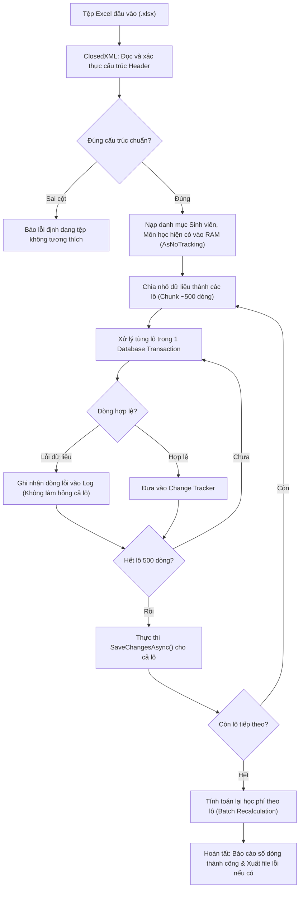

# F09 - Nhập Dữ Liệu Lớn Từ Excel (ClosedXML)

## 1. Mục Tiêu & Yêu Cầu Nghiệp Vụ

Trong thực tế vận hành đầu mỗi năm học, các trường đại học tiếp nhận danh sách hàng nghìn sinh viên trúng tuyển và kế hoạch mở lớp theo từng kỳ. Thao tác nhập liệu thủ công trên giao diện từng dòng là bất khả thi.

Chức năng **Import Excel Thông Minh** được phát triển nhằm:
* Tiếp nhận và phân tích tệp Excel (`.xlsx`) chứa hàng nghìn dòng dữ liệu đào tạo.
* Tự động nhận diện thực thể và thực hiện cơ chế **Upsert** (Cập nhật nếu đã tồn tại, Thêm mới nếu chưa có) đồng thời cho: Sinh viên, Môn học, Học kỳ, Lớp học phần và Đăng ký học phần.
* Đảm bảo tính toàn vẹn, hiệu năng cao và cơ chế cách ly lỗi (Fault Isolation).

---

## 2. Kiến Trúc Xử Lý Theo Lô (Batch Processing) & Cách Ly Lỗi

### Các nguyên tắc kỹ thuật cốt lõi
1. **Phòng chống Lỗi Lan Truyền (Fault Isolation):** Nếu dòng 150 gặp lỗi (ví dụ: ngày sinh sai định dạng, môn học không hợp lệ), hệ thống chỉ ghi lại lỗi của dòng đó vào nhật ký báo cáo và tiếp tục xử lý bình thường dòng 151, không làm hủy bỏ toàn bộ quá trình nạp dữ liệu.
2. **Khắc phục Vấn đề N+1 Query:** Toàn bộ danh mục đối chiếu được nạp vào RAM (`Dictionary<string, int>`) một lần duy nhất trước khi vòng lặp bắt đầu.
3. **Quản lý Bộ nhớ & Change Tracker:** Đặt `AutoDetectChangesEnabled = false` trong quá trình duyệt qua hàng nghìn dòng và chỉ kích hoạt khi ghi theo lô, giữ mức tiêu hao RAM của ứng dụng luôn ổn định dưới 200MB.

---

## 3. Các Tệp Mã Nguồn Triển Khai

* **Giao diện:** `src/QuanLyDKHP.App/Views/ImportExcelView.axaml` và `.axaml.cs`.
* **ViewModel:** `src/QuanLyDKHP.App/ViewModels/ImportExcelViewModel.cs`.
* **Tầng hạ tầng & Repository:** `src/QuanLyDKHP.Infrastructure/Repositories/ImportExcelRepository.cs`.
* **Script tạo dữ liệu thử nghiệm:** `scripts/generate_sample_excel.py`.
* **Kiểm thử tự động:** `tests/QuanLyDKHP.Tests/ImportExcelServiceTests.cs`.
