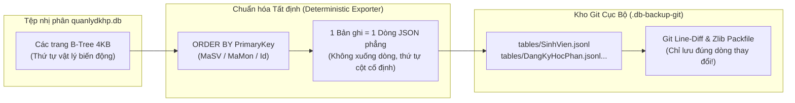
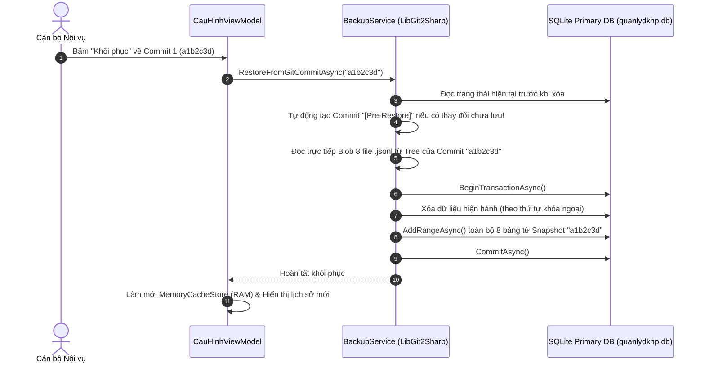

# F11b - Giải Phẫu Cơ Chế Sao Lưu CSDL Kiểu Git (`LibGit2Sharp`) & Ví Dụ Minh Họa Thực Tế

Tài liệu này là phần mở rộng chuyên sâu của **[F11 - CSDL SQLite Cục Bộ Chính & Sao Lưu Phiên Bản Kiểu Git](./F11-local-sqlite-git-backup.md)**, giải thích tường tận cách hệ thống biến cơ sở dữ liệu quan hệ SQLite thành một kho lưu trữ được quản lý phiên bản bởi **Git**, kèm theo các **ví dụ dữ liệu thực tế** và **kịch bản kiểm thử tự động (`BackupServiceTests.cs`)**.

---

## 1. Tại Sao Không Đưa Trực Tiếp File `.db` Vào Git Mà Phải Dùng Canonical JSONL?

Khi nghe đến ý tưởng *"dùng Git để quản lý bản sao lưu cơ sở dữ liệu như quản lý code"*, cách tiếp cận ngây thơ nhất là chạy `git add quanlydkhp.db` rồi `git commit` mỗi ngày. Tuy nhiên, cách đó **thất bại về mặt kỹ thuật** vì 3 lý do:

1. **Cấu trúc trang nhị phân B-Tree của SQLite:** SQLite chia tệp `.db` thành các trang nhị phân (Pages, mặc định `4096 bytes`). Khi cán bộ chỉ sửa **1 điểm số** hoặc chèn **1 sinh viên**, SQLite có thể thực hiện cân bằng lại cây B-Tree (Page Split / Rebalancing), làm thay đổi hàng loạt byte ở nhiều vị trí khác nhau trong tệp nhị phân.
2. **Mất khả năng nén vi sai theo dòng (Line-Delta Compression):** Git được thiết kế tối ưu cho **văn bản chia theo dòng (Line-oriented text)**. Với tệp nhị phân `.db` bị xáo trộn trang, Git khó tìm được chuỗi tương đồng dài và buộc phải lưu lại phần lớn tệp mới trong `.git/objects`, khiến dung lượng kho Git phình to nhanh chóng.
3. **Mù thông tin kiểm toán (Opaque Diff):** Khi xem lại lịch sử `git diff` trên tệp `.db`, người quản trị chỉ thấy dòng chữ `Binary files a/quanlydkhp.db and b/quanlydkhp.db differ` — hoàn toàn không biết ngày hôm đó bảng nào hay sinh viên nào bị sửa.

### Giải pháp của dự án: Ánh xạ 1 Bản ghi (Row) $\leftrightarrow$ 1 Dòng văn bản cố định (Canonical Sorted Line)



Để Git đối xử với CSDL giống hệt như mã nguồn C#, [`BackupService.cs`](file:///Users/caotiendattx/Developer/Do_An_Desktop/QLiDKHP/src/QuanLyDKHP.Infrastructure/Services/BackupService.cs) áp dụng 2 quy tắc bất biến khi xuất dữ liệu:
* **Quy tắc 1 — Mỗi bản ghi là đúng 1 dòng văn bản (`JSON Lines - .jsonl`):** Sử dụng `JsonSerializerOptions { WriteIndented = false }`. Nếu bảng `SinhVien` có `10.000` sinh viên, tệp `SinhVien.jsonl` sẽ có đúng `10.000` dòng.
* **Quy tắc 2 — Thứ tự dòng tất định (`Deterministic Primary-Key Ordering`):** Bất kể dữ liệu trong SQLite được chèn hay cập nhật theo thứ tự nào, khi xuất ra tệp `.jsonl`, hệ thống luôn ép sắp xếp theo khóa chính (`ORDER BY MaSV`, `ORDER BY MaMon`, `ORDER BY MaSV, MaLHP, Id`). Nhờ đó, một bản ghi không bị thay đổi sẽ **luôn nằm ở nguyên vị trí tương đối của nó**, giúp thuật toán Myers Diff của Git nhận diện chính xác 100% những bản ghi nào được thêm (`+`), xóa (`-`), hoặc sửa (`-` dòng cũ, `+` dòng mới).

---

## 2. Cấu Trúc Thư Mục Vật Lý Của Hệ Thống Sao Lưu

Trên máy tính cố định tại văn phòng, toàn bộ dữ liệu và kho Git sao lưu được tổ chức tại thư mục `%LocalAppData%/QuanLyDKHP/`:

```text
QuanLyDKHP/
├── quanlydkhp.db                   # CSDL SQLite chính (Đang chạy ở chế độ WAL)
├── quanlydkhp.db-wal               # Write-Ahead Log phục vụ đọc/ghi đồng thời
├── quanlydkhp.db-shm               # Shared-memory index của WAL
└── Backups/
    ├── latest_snapshot.db          # Bản chụp nhị phân nóng (Online Backup API)
    └── GitRepo/                    # Kho lưu trữ Git nội bộ (Quản lý bởi LibGit2Sharp)
        ├── .git/                   # Cơ sở dữ liệu đối tượng của Git (Commits, Trees, Blobs nén Zlib)
        ├── .gitignore              # Chặn các file .db/.tmp, chỉ theo dõi thư mục tables/
        └── tables/                 # Working Tree chứa 8 bảng chuẩn hóa theo dòng
            ├── NguoiDung.jsonl         (ORDER BY Id)
            ├── CauHinhHeThong.jsonl    (ORDER BY Key)
            ├── HocKy.jsonl             (ORDER BY MaHocKy)
            ├── MonHoc.jsonl            (ORDER BY MaMon)
            ├── SinhVien.jsonl          (ORDER BY MaSV)
            ├── LopHocPhan.jsonl        (ORDER BY MaLHP)
            ├── DangKyHocPhan.jsonl     (ORDER BY MaSV, MaLHP, Id)
            └── HocPhiHocKy.jsonl       (ORDER BY MaSV, MaHocKy, Id)
```

---

## 3. Ví Dụ Thực Tế Từng Bước (Dựa Trên Kịch Bản Kiểm Thử Trong Code)

Để hình dung rõ nhất cách Git lưu trữ và tính toán sự thay đổi dữ liệu qua từng ngày, hãy theo dõi kịch bản thực tế được trích trực tiếp từ bài kiểm thử tự động `GitBackup_CanonicalJsonl_LineLevelDeltaDiff_TracksExactRowChanges` trong [`BackupServiceTests.cs`](file:///Users/caotiendattx/Developer/Do_An_Desktop/QLiDKHP/tests/QuanLyDKHP.Tests/BackupServiceTests.cs).

### Bước 1: Ngày làm việc thứ nhất — Nhập dữ liệu lộn xộn & Tạo Commit đầu tiên (`Baseline`)

Giả sử trong ngày đầu tiên, cán bộ nội vụ thêm 3 sinh viên vào CSDL SQLite theo thứ tự **không sắp xếp** (`SV003` nhập trước, rồi đến `SV001`, cuối cùng là `SV002`):

```csharp
db.SinhViens.AddRange(
    new SinhVien { MaSV = "SV003", HoTen = "Lê Văn C",   LopSinhHoat = "CNTT1", KhoaHoc = "K26" },
    new SinhVien { MaSV = "SV001", HoTen = "Nguyễn Văn A", LopSinhHoat = "CNTT1", KhoaHoc = "K26" },
    new SinhVien { MaSV = "SV002", HoTen = "Trần Thị B", LopSinhHoat = "CNTT1", KhoaHoc = "K26" }
);
await db.SaveChangesAsync();
```

Khi chương trình chạy sao lưu cuối ngày (`CreateLocalGitBackupAsync("Auto-Daily", "Baseline ngày 1")`):
1. Phương thức `ExportCanonicalJsonlAsync()` truy vấn `local.SinhViens.AsNoTracking().OrderBy(x => x.MaSV)` và ghi ra tệp `tables/SinhVien.jsonl`.
2. Mặc dù lúc nhập vào SQLite thì `SV003` đứng đầu, nhưng tệp `tables/SinhVien.jsonl` được chuẩn hóa thứ tự dòng như sau:

```json title="tables/SinhVien.jsonl (Tại thời điểm Commit 1)"
{"MaSV":"SV001","HoTen":"Nguy\u1EC5n V\u0103n A","LopSinhHoat":"CNTT1","KhoaHoc":"K26","NgayTao":"2026-11-08T10:00:00Z","NgayCapNhat":null,"IsDeleted":false,"DangKyHocPhans":[]}
{"MaSV":"SV002","HoTen":"Tr\u1EA7n Th\u1ECB B","LopSinhHoat":"CNTT1","KhoaHoc":"K26","NgayTao":"2026-11-08T10:00:00Z","NgayCapNhat":null,"IsDeleted":false,"DangKyHocPhans":[]}
{"MaSV":"SV003","HoTen":"L\u00EA V\u0103n C","LopSinhHoat":"CNTT1","KhoaHoc":"K26","NgayTao":"2026-11-08T10:00:00Z","NgayCapNhat":null,"IsDeleted":false,"DangKyHocPhans":[]}
```

3. `LibGit2Sharp` so sánh với cây rỗng ban đầu và tạo **Commit 1** với tóm tắt biến động:
   * `ChangedTablesSummary`: **`CauHinhHeThong (+4), NguoiDung (+1), SinhVien (+3)`** (4 cấu hình mặc định, 1 tài khoản admin, 3 sinh viên mới).

---

### Bước 2: Chống tạo Commit rác khi dữ liệu không đổi (`Idempotency Check`)

Nếu vài phút sau (hoặc ngày hôm sau không có ai làm việc), tiến trình tự động gọi lại:
```csharp
var skipped = await backupService.CreateLocalGitBackupAsync("Auto-Daily", skipIfNoChanges: true);
```
* Hệ thống vẫn xuất lại các tệp `.jsonl`.
* Vì thứ tự `ORDER BY` và định dạng JSON hoàn toàn tất định, nội dung các tệp `.jsonl` **giống hệt từng byte** so với Commit 1.
* Khi gọi `repo.RetrieveStatus()`, thuộc tính `status.IsDirty` trả về `false`. Hàm lập tức trả về `null` và **không sinh ra bất kỳ bản Commit thừa nào**.

---

### Bước 3: Ngày làm việc thứ hai — Chỉnh sửa 1 sinh viên & Thêm mới 1 sinh viên (`Delta Commit`)

Sang ngày thứ hai, cán bộ nội vụ thực hiện 2 thao tác trên ứng dụng:
1. Chuyển lớp sinh hoạt của sinh viên `SV002` từ `"CNTT1"` sang `"KTPM2"`.
2. Thêm mới sinh viên `SV004` (`Phạm Văn D`, lớp `"HTTT1"`).
*(Hai sinh viên `SV001` và `SV003` không hề bị đụng chạm).*

```csharp
var sv2 = await db.SinhViens.FindAsync("SV002");
sv2.LopSinhHoat = "KTPM2";

db.SinhViens.Add(new SinhVien { MaSV = "SV004", HoTen = "Phạm Văn D", LopSinhHoat = "HTTT1", KhoaHoc = "K27" });
await db.SaveChangesAsync();
```

Khi kết thúc ngày thứ hai, hệ thống gọi `CreateLocalGitBackupAsync("Auto-Daily", "Cập nhật cuối ngày 2")`. Hãy xem điều gì xảy ra bên trong kho Git (`repo.Diff.Compare<Patch>`):

```diff title="Kết quả Git Diff thực tế trên tệp tables/SinhVien.jsonl (Commit 1 -> Commit 2)"
 {"MaSV":"SV001","HoTen":"Nguy\u1EC5n V\u0103n A","LopSinhHoat":"CNTT1","KhoaHoc":"K26","NgayTao":"2026-11-08T10:00:00Z","NgayCapNhat":null,"IsDeleted":false,"DangKyHocPhans":[]}
-{"MaSV":"SV002","HoTen":"Tr\u1EA7n Th\u1ECB B","LopSinhHoat":"CNTT1","KhoaHoc":"K26","NgayTao":"2026-11-08T10:00:00Z","NgayCapNhat":null,"IsDeleted":false,"DangKyHocPhans":[]}
+{"MaSV":"SV002","HoTen":"Tr\u1EA7n Th\u1ECB B","LopSinhHoat":"KTPM2","KhoaHoc":"K26","NgayTao":"2026-11-08T10:00:00Z","NgayCapNhat":"2026-11-09T03:00:00Z","IsDeleted":false,"DangKyHocPhans":[]}
 {"MaSV":"SV003","HoTen":"L\u00EA V\u0103n C","LopSinhHoat":"CNTT1","KhoaHoc":"K26","NgayTao":"2026-11-08T10:00:00Z","NgayCapNhat":null,"IsDeleted":false,"DangKyHocPhans":[]}
+{"MaSV":"SV004","HoTen":"Ph\u1EA1m V\u0103n D","LopSinhHoat":"HTTT1","KhoaHoc":"K27","NgayTao":"2026-11-09T03:00:00Z","NgayCapNhat":null,"IsDeleted":false,"DangKyHocPhans":[]}
```

:::tip[Điểm đắt giá của kiến trúc]
Quan sát đoạn `diff` ở trên:
* Dòng `SV001` và `SV003` hoàn toàn không thay đổi.
* Dòng `SV002` cũ được đánh dấu `-` (1 dòng xóa) và thay bằng dòng `SV002` mới có `"LopSinhHoat":"KTPM2"` được đánh dấu `+` (1 dòng thêm).
* Dòng `SV004` mới nằm ở cuối được đánh dấu `+` (1 dòng thêm).
* Toàn bộ 7 bảng còn lại (`NguoiDung.jsonl`, `MonHoc.jsonl`, `DangKyHocPhan.jsonl`...) có mã băm `SHA-1` không đổi nên **Git tái sử dụng hoàn toàn con trỏ `Blob` của Commit 1 mà không tốn thêm 1 byte lưu trữ nào!**
* Hàm `BuildDiffSummary(repo)` đếm từ `Patch` của `LibGit2Sharp`: `LinesAdded = 2`, `LinesDeleted = 1` $\rightarrow$ Tự động ghi vào lịch sử Commit: **`SinhVien (+2, -1)`**.
:::

---

### Bước 4: Khôi phục Du hành Thời gian (`Time-Travel Restore`) & Chốt chặn `Pre-Restore`

Giả sử sang ngày thứ ba, cán bộ nội vụ lỡ tay xóa nhầm hoặc nhập sai hàng loạt dữ liệu (mà **chưa kịp bấm nút Sao lưu**), sau đó vào màn hình **Cấu hình hệ thống** và bấm nút **"Khôi phục"** về bản lưu `Commit 1`.

Nếu một hệ thống thông thường chỉ đơn giản xóa sạch CSDL hiện tại rồi chép đè bản `Commit 1` vào, thì toàn bộ dữ liệu làm việc dở dang trong ngày thứ ba sẽ **mất vĩnh viễn** (nếu cán bộ phát hiện ra mình chọn nhầm bản Commit quá cũ thì không thể quay lại).

Để triệt tiêu rủi ro đó, hàm `RestoreFromGitCommitAsync` trong [`BackupService.cs`](file:///Users/caotiendattx/Developer/Do_An_Desktop/QLiDKHP/src/QuanLyDKHP.Infrastructure/Services/BackupService.cs) thực thi quy trình 4 bước:



1. **Tự động chụp điểm an toàn (`[Pre-Restore]`):** Ngay trước khi đụng vào CSDL, hệ thống gọi:
   ```csharp
   await CreateLocalGitBackupAsync("Pre-Restore", $"Lưu tự động trước khi khôi phục về {commitSha[..7]}", skipIfNoChanges: true);
   ```
2. **Đọc trực tiếp từ `Commit.Tree` trong Git Object Database:** Hệ thống không cần `git checkout` làm xáo trộn thư mục mà đọc thẳng luồng nhị phân (`Blob.GetContentStream()`) của 8 tệp `.jsonl` nằm trong `commit["tables"]`.
3. **Khôi phục nguyên tử trong Giao dịch (`Database Transaction`):** Toàn bộ thao tác xóa dữ liệu cũ và nạp lại 8 bảng từ Commit đích nằm gọn trong `await using var tx = await local.Database.BeginTransactionAsync()`. Nếu có bất kỳ lỗi nào xảy ra giữa chừng, `await tx.RollbackAsync()` đảm bảo CSDL không bao giờ rơi vào trạng thái nửa vời.
4. **Khả năng "Hoàn tác lệnh Khôi phục" (`Undo Restore`):** Như đã chứng minh trong bài test `RestoreFromGitCommit_CreatesPreRestoreSafetyCommit`, ngay sau khi khôi phục về `Commit 1`, trong bảng lịch sử sẽ xuất hiện thêm dòng `[Pre-Restore]`. Nếu cán bộ muốn quay lại đúng trạng thái trước lúc bấm nút Khôi phục, chỉ cần bấm **"Khôi phục"** vào dòng `[Pre-Restore]` đó!

---

## 4. Mã Nguồn Kiểm Thử Minh Chứng (`BackupServiceTests.cs`)

Toàn bộ các cơ chế mô tả ở trên đều được kiểm chứng tự động bằng bộ kiểm thử tích hợp thực tế (chạy trên SQLite thật và kho Git thật của `LibGit2Sharp`) tại tệp [`tests/QuanLyDKHP.Tests/BackupServiceTests.cs`](file:///Users/caotiendattx/Developer/Do_An_Desktop/QLiDKHP/tests/QuanLyDKHP.Tests/BackupServiceTests.cs):

```csharp title="Trích đoạn kiểm thử tự động trong tests/QuanLyDKHP.Tests/BackupServiceTests.cs"
[Fact]
public async Task GitBackup_CanonicalJsonl_LineLevelDeltaDiff_TracksExactRowChanges()
{
    var backupService = new BackupService(_dbContextFactory, null, _testDir);

    // 1. Chèn 3 sinh viên theo thứ tự ngẫu nhiên (SV003 -> SV001 -> SV002)
    using (var db = _dbContextFactory.CreateDbContext())
    {
        db.SinhViens.AddRange(
            new SinhVien { MaSV = "SV003", HoTen = "Lê Văn C", LopSinhHoat = "CNTT1", KhoaHoc = "K26" },
            new SinhVien { MaSV = "SV001", HoTen = "Nguyễn Văn A", LopSinhHoat = "CNTT1", KhoaHoc = "K26" },
            new SinhVien { MaSV = "SV002", HoTen = "Trần Thị B", LopSinhHoat = "CNTT1", KhoaHoc = "K26" }
        );
        await db.SaveChangesAsync();
    }

    // Tạo Commit 1 (Baseline)
    var commit1 = await backupService.CreateLocalGitBackupAsync("Auto-Daily", "Baseline ngày 1");
    Assert.NotNull(commit1);
    Assert.Contains("SinhVien (+3)", commit1.ChangedTablesSummary);

    // Kiểm tra file SinhVien.jsonl đã được chuẩn hóa thứ tự (ORDER BY MaSV: SV001 -> SV002 -> SV003)
    var svJsonlPath = Path.Combine(_testDir, "GitRepo", "tables", "SinhVien.jsonl");
    var linesDay1 = await File.ReadAllLinesAsync(svJsonlPath);
    Assert.Equal(3, linesDay1.Length);
    Assert.Contains("\"MaSV\":\"SV001\"", linesDay1[0]);
    Assert.Contains("\"MaSV\":\"SV002\"", linesDay1[1]);
    Assert.Contains("\"MaSV\":\"SV003\"", linesDay1[2]);

    // 2. Gọi lại khi không có thay đổi (skipIfNoChanges: true) -> Không tạo commit rác
    var skippedCommit = await backupService.CreateLocalGitBackupAsync("Auto-Daily", "Không đổi", skipIfNoChanges: true);
    Assert.Null(skippedCommit);

    // 3. Ngày 2: Sửa lớp của SV002 ("CNTT1" -> "KTPM2") và thêm mới SV004
    using (var db = _dbContextFactory.CreateDbContext())
    {
        var sv2 = await db.SinhViens.FindAsync("SV002");
        sv2!.LopSinhHoat = "KTPM2";

        db.SinhViens.Add(new SinhVien { MaSV = "SV004", HoTen = "Phạm Văn D", LopSinhHoat = "HTTT1", KhoaHoc = "K27" });
        await db.SaveChangesAsync();
    }

    // Tạo Commit 2 (Delta): Sửa 1 dòng (-1, +1) + Thêm 1 dòng (+1) => SinhVien (+2, -1)
    var commit2 = await backupService.CreateLocalGitBackupAsync("Auto-Daily", "Cập nhật cuối ngày 2");
    Assert.NotNull(commit2);
    Assert.Equal("SinhVien (+2, -1)", commit2.ChangedTablesSummary);
}
```

### Kết quả thực thi bộ kiểm thử (`dotnet test`)
```text
Test run for tests/QuanLyDKHP.Tests/bin/Debug/net8.0/QuanLyDKHP.Tests.dll (.NETCoreApp,Version=v8.0)
Passed!  - Failed:     0, Passed:    50, Skipped:     0, Total:    50, Duration: 2 s
```
